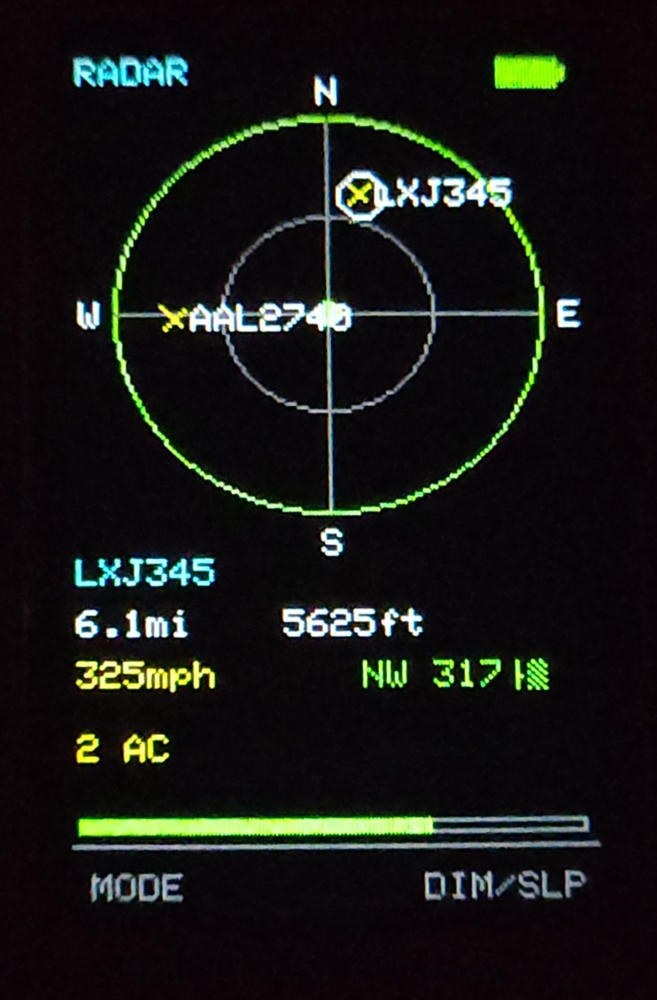
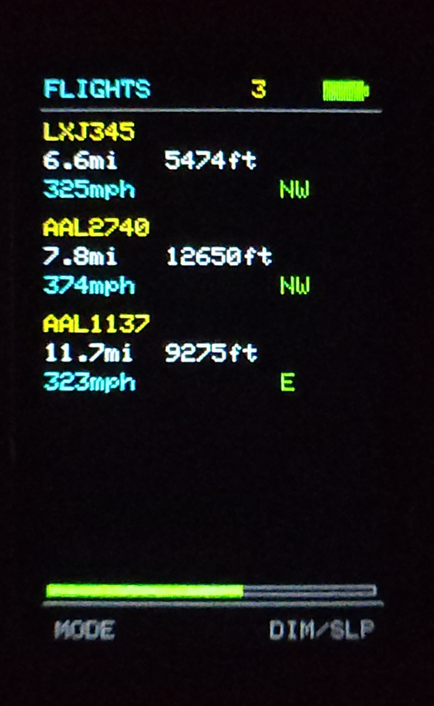

# ESP32 Flight Radar

A portable real-time aircraft radar built on an ESP32 and ST7789 display using live aircraft data from the OpenSky Network.

The project displays nearby aircraft in both a traditional aircraft list view and a radar-style tactical display. Aircraft are plotted relative to your location and include heading, altitude, speed, distance, directional vectors, and historical movement trails.

Designed for inexpensive ESP32 display modules such as the Tenstar ESP32 Display Board and LilyGO T-Display style hardware.

---

## Screenshots

### Radar View



### List View



---

## Features

### Aircraft Tracking

- Live aircraft data from OpenSky Network
- OAuth2 authentication support
- Automatic refresh scheduling
- Manual refresh capability
- Aircraft sorting by nearest distance
- Callsign display
- Altitude display
- Ground speed display
- Heading display

### Radar Display

- 10-mile radar range
- Aircraft plotted by real-world bearing and distance
- Compass overlay
- Home position marker
- Directional aircraft vector symbols
- Aircraft movement trails
- Closest-aircraft highlighting
- Aircraft labels
- Altitude-based color coding

### Aircraft List View

- Five nearest aircraft
- Distance from home location
- Altitude
- Speed
- Heading
- Callsign

### Power Management

- Battery monitoring
- Battery icon display
- Adjustable brightness levels
- Deep sleep mode
- Button wake-up
- Low-power operation

### User Interface

- Radar mode
- Aircraft list mode
- Update progress indicator
- Battery status indicator
- Physical button controls

---

## Hardware

### Tested Hardware

- ESP32 Dev Module
- Tenstar ESP32 Display Board
- LilyGO T-Display Style Boards
- ST7789 135×240 LCD

### Display Connections

```cpp
#define TFT_CS     5
#define TFT_DC    16
#define TFT_RST   23
#define TFT_MOSI  19
#define TFT_SCLK  18
#define TFT_BL     4
```

### Controls

```cpp
#define BTN_MODE    35
#define BTN_SCREEN   0
```

---

## Controls

### MODE Button

Short Press

```text
LIST VIEW
    ⇄
RADAR VIEW
```

### DIM / SLEEP Button

Short Press

```text
100%
50%
25%
10%
```

Long Press

```text
Deep Sleep Mode
```

Press again to wake the device.

---

## Radar Color Legend

### Green

```text
Aircraft below 5,000 ft
```

### Yellow

```text
Aircraft between 5,000 ft and 20,000 ft
```

### Red

```text
Aircraft above 20,000 ft
```

---

## Aircraft Information

Each aircraft can display:

```text
Callsign
Distance
Altitude
Ground Speed
Heading
Flight Direction
Trail History
```

Example:

```text
AAL943
4.2 mi
12,049 ft
287 mph
NW 312°
```

---

## Project Structure

```text
FlightRadar.ino
│
├── Wi-Fi
├── OpenSky Authentication
├── Update Scheduler
├── Button Handling
├── Battery Management
└── Power Management

AircraftData.h
│
├── Aircraft Storage
├── Trail History
├── Distance Calculations
├── Bearing Calculations
├── Sorting Logic
└── OpenSky Data Retrieval

DisplayUI.h
│
├── Radar Rendering
├── List Rendering
├── Aircraft Vector Rendering
├── Battery Indicator
├── Progress Indicator
└── Display Helpers
```

---

## Polling Strategy

Default update interval:

```text
30 seconds
```

Recommended for continuous operation and OpenSky API credit conservation.

Development mode:

```text
10 seconds
```

Useful for testing and debugging radar features.

---

## OpenSky Integration

The project retrieves aircraft state vectors from OpenSky Network and supports OAuth2 client credentials authentication.

Information displayed includes:

- Callsign
- Latitude / Longitude
- Bearing
- Altitude
- Speed
- Track Heading

OpenSky Network:

https://opensky-network.org/

---

## Flight Trail System

Aircraft movement trails are preserved between updates and displayed directly on the radar scope.

Trail history allows visual tracking of:

- Aircraft direction
- Relative movement
- Traffic patterns
- Nearby approaches and departures

---

## Future Improvements

Potential future features include:

- Aircraft type lookups
- Tail number lookup
- Airport overlays
- DFW/DAL markers
- Multiple radar ranges
- Weather overlays
- GPS-based mobile operation
- SD card logging
- Historical playback
- Aircraft detail screens

---

## Building

### Arduino IDE

Board:

```text
ESP32 Dev Module
```

Recommended settings:

```text
CPU Frequency: 240 MHz
Flash Frequency: 80 MHz
Partition Scheme: Default 4MB with SPIFFS
```

Required libraries:

```text
ArduinoJson
Adafruit GFX
Adafruit ST7789
```

---

## License

MIT License

Copyright (c) 2026 Christian Brannon

Permission is hereby granted, free of charge, to any person obtaining a copy
of this software and associated documentation files to deal in the Software
without restriction, including without limitation the rights to use, copy,
modify, merge, publish, distribute, sublicense, and/or sell copies of the
Software.
